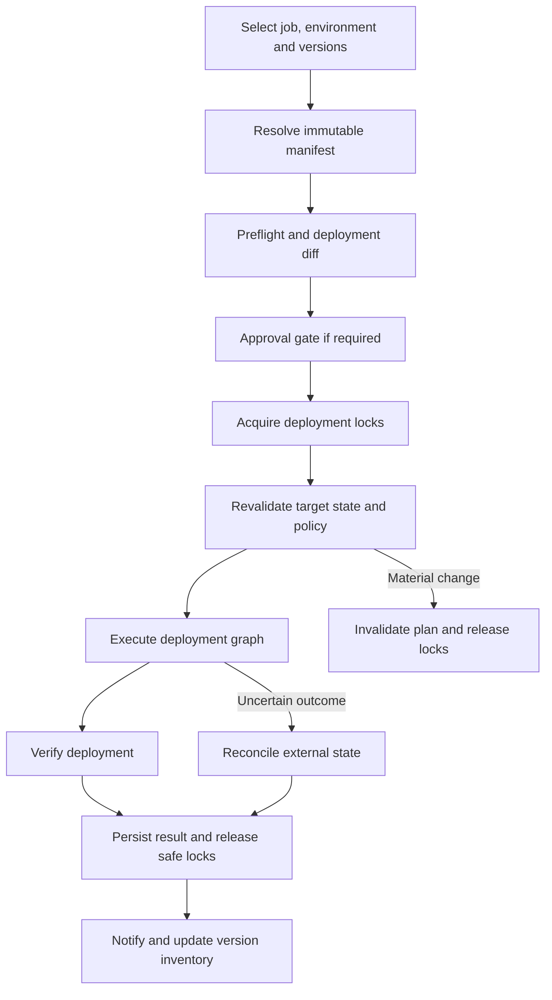

# Yamdrake — Architecture and Design Review

**Date:** 27 November 2026  
**Status:** Recommendations for design approval  
**Scope:** AWS-native ECS deployment orchestration. Frontend application deployments are explicitly excluded; the React management UI remains in scope.

## 1. Executive assessment

The proposed architecture is sound. Keep Go, React, ECS Fargate, PostgreSQL as the durable queue and source of truth, Valkey for ephemeral data, S3 for logs and artifacts, SSE for live updates, and the orchestrator/runner separation. YAML-driven inventory and built-in deployment steps are appropriate for replacing Jenkins without recreating a general-purpose CI platform.

The main gaps concern production safety, immutable deployment inputs, concurrency, recovery, configuration restoration, and governance. Yamdrake should manage the complete deployment lifecycle, not merely execute steps.

This review covers the supplied written design, not the linked clickable mockup. YAML examples below are proposed syntax, not approved schemas.

## 2. Critical architectural issues

### 2.1 Deployment lifecycle locking

The proposed leg-level lock permits a race: run A copies configuration A and releases its lock; run B copies configuration B; run A then deploys image A with configuration B.

- Hold locks across the entire target deployment lifecycle, from the first mutation through verification and reconciliation.
- Use canonical resource identifiers (ECS service ARN and shared S3 destination keys), not logical inventory names.
- Acquire multiple locks atomically or in a deterministic order to avoid deadlocks.
- Keep locks while an external deployment is still active or its outcome is uncertain. Provide an audited reconciliation procedure for abandoned locks.
- Do not hold deployment locks while waiting for human approval.

### 2.2 Immutable deployment manifests

Snapshotting job and inventory YAML is insufficient. ECR tags, GitHub branches, S3 objects and current ECS task definitions can change between approval and execution.

Resolve a deployment manifest before approval and bind approval to its immutable identity. Example:

```yaml
deployment:
  environment: hetzner-01
  inventory_commit: a7f82c1
  job_commit: b8d93e2
  services:
    backend-api:
      version: '2.212.0'
      image_digest: 'sha256:abc123...'
      previous_task_definition: backend-api:142
      configuration:
        - source: github
          commit: d9e41f2
          path: backend-api.env
          checksum: 'sha256:...'
        - source: s3
          version_id: example-version-id
          checksum: 'sha256:...'
```

Deploy by image digest, pin GitHub content to commits, and use S3 object versions or protected immutable copies. Revalidate target state after acquiring locks. Material changes invalidate the plan and require renewed approval. Encrypt and restrict access to configuration snapshots.

### 2.3 Configuration restoration

Deploying an old image does not necessarily restore its old configuration. ECS circuit-breaker rollback may restore the task definition while leaving newly copied S3 configuration in place.

Keep automatic rollback outside Yamdrake's scope, but provide a manual **Restore deployment** action using the exact previous task definition and configuration artifacts. Apply the same permission, approval and locking rules as normal deployments. Prefer immutable configuration paths referenced by task definitions where possible. Clearly report partial configuration writes and ECS-initiated rollback.

### 2.4 Runner recovery and reconciliation

A runner can crash after an AWS API succeeds but before recording the result. PostgreSQL leases alone cannot guarantee exactly-once execution.

- Use lease heartbeats, fencing tokens for database updates, and durable execution checkpoints.
- Define a recovery contract for every built-in step, including reconciliation with actual AWS state.
- Record operation intent before external mutations and reconcile ambiguous responses before retrying.
- Prevent stale runners from continuing where possible; database fencing does not fence AWS API calls.
- Introduce a `needs_reconciliation` state for uncertain outcomes.
- Test crashes immediately before and after external API calls.

The execution model should be described as **at-least-once execution with reconciliation**.

### 2.5 Separate AWS IAM roles

Sections 11 and 15 contradict each other: using the same deployment connection for both services would give the orchestrator write privileges.

| Component | Target account role |
|---|---|
| Orchestrator | Discovery role: ECS describe, ECR list/describe, required read-only metadata |
| Runner | Deployment role: scoped ECS mutations, S3 writes, required reads |
| Script task | Dedicated, narrowly scoped task role |

Prefer STS AssumeRole over long-lived access keys. Restrict `iam:PassRole` to approved task and execution roles. Scope role trust and resource permissions to the intended accounts and resources.

## 3. Missing deployment capabilities

### 3.1 Preflight and deployment diff

Before execution, check role assumption, ECS service existence, image digest, configuration sources, target state, and resource conflicts. Show the current versus requested image, task definition changes, configuration changes and affected resources, with sensitive values redacted.

Preflight must not mutate AWS resources. Mark permissions that cannot be reliably verified without writing as unverified. Repeat critical checks immediately before execution.

### 3.2 Deployment verification

ECS stability alone does not establish application health. Add a built-in `verify` step supporting HTTP smoke tests, ECS/ALB health and CloudWatch alarms.

```yaml
- name: verify-backends
  use: verify
  group: backends
  needs: [roll-backends]
  timeout: 5m
  checks:
    - type: http
      expected_status: 200
      retries: 5
    - type: ecs-health
      minimum_healthy_percent: 100
    - type: cloudwatch-alarm
      require: OK
```

Endpoints and alarm names should come from inventory. Define handling for insufficient alarm data, network reachability, and zero desired task count. Verify that the intended revision actually completed, not merely that ECS returned to a stable state after rollback.

### 3.3 Concurrency control

Bound concurrency globally, per AWS account, per environment, and per job or step. This protects AWS quotas, API rate limits, application availability and runner capacity. Use fair scheduling and bounded retry with jitter for transient API failures.

```yaml
execution:
  max_parallel: 5
steps:
  - name: roll-backends
    use: ecs-deploy
    group: backends
    max_parallel: 2
    failure_policy: continue
```

### 3.4 Cancellation

Cancellation belongs in version 1. It is not rollback.

| Leg state | Behaviour |
|---|---|
| Pending or queued | Cancel without executing |
| Copying configuration | Stop at a safe checkpoint; record changes |
| ECS deployment submitted | Continue observing the external rollout |
| Script task running | Request task stop and confirm termination |
| Completed | Leave unchanged |

Add `cancelling` and `cancelled` states. Show which resources were changed. Keep locks until external work reaches a safe terminal state. Define separate deadlines for queue waiting, execution and reconciliation.

## 4. YAML model

### 4.1 Dependency semantics

Support both whole-step barriers and per-service dependencies. Independent microservices should normally continue when another service's configuration fails; tightly coupled releases may require a whole-step barrier. A barrier does not guarantee atomic deployment.

```yaml
- name: roll-backends
  use: ecs-deploy
  group: backends
  needs:
    - step: config-backends
      scope: service
```

Prefer explicit `needs` declarations over implicit dependency on the preceding step. Validate service-scoped dependencies and define empty-group and skipped-leg behaviour.

### 4.2 Schema versioning

Include schema versions from day one and publish JSON schemas for IDE completion and CI validation.

```yaml
apiVersion: yamdrake.io/v1
kind: DeploymentJob
metadata:
  name: deploy-backend
spec:
  # Job definition
```

Reject unknown fields and invalid references. Activate coherent inventory snapshots rather than mixing incompatible file revisions. Display last-good definitions and their sync age; define when stale definitions block production runs.

### 4.3 Reusable workflows (later)

Allow versioned declarative workflow templates when repeated jobs become a maintenance burden. Avoid arbitrary templating languages, loops and embedded programming logic.

### 4.4 Configurable version selection

Do not hardcode semantic version tags. Configure matching and sorting per ECR repository or service.

```yaml
versions:
  pattern: '^v?\d+\.\d+\.\d+(-rc\d+)?$'
  sort: semver
  limit: 100
```

Resolve the selected tag to a digest before approval. Define pagination and sorting for non-semver tags.

## 5. Security and governance

### 5.1 Environment protection policies

Job YAML alone must not control production approval: someone editing a job could remove its approval requirement. Centrally managed policies should define minimum approvers, self-approval restrictions, preflight requirements, permitted configuration fallback, immutable image requirements, script restrictions and concurrency limits. Jobs may strengthen but never weaken these policies.

Remove the ordinary global-admin self-approval exception for production. Provide separately audited break-glass access. Recheck authorization and protection policies before dispatching work.

### 5.2 Granular permissions

Support `view`, `view_logs`, `run`, `cancel`, `approve`, `restore`, `manage_jobs`, `manage_connections`, `manage_access`, and `view_audit`. Scope permissions by environment label, specific environment and optionally folder. Enforce permissions in REST, SSE and CLI endpoints, not only the UI. Define session/token revocation and SAML group membership refresh.

### 5.3 Generic `run` step

Treat arbitrary container commands as a separate security boundary. Defer this step until the ECS deployment engine is reliable.

Require approved registries/images pinned by digest, reviewed source pinned to a commit, restricted networking, dedicated task roles, CPU/memory/time limits and restricted output destinations. Never expose runner credentials to scripts. Validate inputs and avoid unsafe shell interpolation. Define success to include required output upload, not only command exit code. GitHub branch protection and reviewed changes are part of the security model.

### 5.4 Secret handling

Implement structured redaction, sensitive input types, encrypted configuration artifacts, restricted log access and explicit retention policies. Avoid logging request bodies or configuration contents. Redaction is best-effort, particularly for arbitrary scripts. Prefer Secrets Manager references over plaintext credentials in GitHub.

## 6. Operational safety

### 6.1 Deployment freeze

Allow administrators to block new deployments by environment or label without editing YAML or IAM. Store reason, owner, expiry and audit history. Define whether queued and already-running deployments continue. Any bypass must be explicitly authorized and audited.

### 6.2 Partial success and unknown outcomes

Distinguish succeeded, partially succeeded, failed, cancelled and needs reconciliation. Retain detailed service-level outcomes and counts. Partial success must return a nonzero CLI exit code. Define terminal-state precedence and ensure uncertain external operations are not reported as successful.

### 6.3 Configuration branch fallback

Never silently fall back to `dev` for production configuration. Make fallback explicit by environment label, with production and preproduction disabled by default. Missing required configuration should fail preflight.

```yaml
configuration:
  branch:
    strategy: version
    fallback:
      dev: dev
      preprod: null
      prod: null
```

### 6.4 Durable logging

The promise of complete logs conflicts with accepting loss of recent Valkey entries. Keep Valkey for live delivery and S3 for durable storage, but define acknowledged durable ingestion, unique event identifiers, ordering, deduplication and gap detection. A durable spool or PostgreSQL outbox can bridge ingestion and S3 persistence. Explicitly distinguish acknowledged logs from output lost before ingestion. Support SSE reconnect via `Last-Event-ID` and replay from durable storage.

## 7. Management UI additions

These recommendations concern Yamdrake's own management UI, not frontend application deployments.

| Screen or feature | Purpose |
|---|---|
| Deployment queue | Active/queued work, blocked targets, lock owners, runner capacity and waiting times |
| Service details | Current and previous versions, deployment history, configuration revisions, task definitions and restore action |
| Deployment diff | Current versus requested state, with redacted sensitive data |
| Environment management | Protection policies, freezes, permissions and concurrency limits |
| System health | Runner health, queue depth, expired leases, sync status and connection health |
| Versions matrix enhancements | Mixed task revisions, external deployments, desired versus actual state and configuration drift |

Advanced drift detection can follow version 1.

## 8. Yamdrake observability and operations

Use CloudWatch metrics and alarms without introducing a separate monitoring stack.

| Metric | Purpose |
|---|---|
| QueueDepth | Pending work |
| OldestQueuedLegAge | Stuck queues |
| ActiveRunners | Execution capacity |
| ExpiredLeases | Runner failures |
| DeploymentDuration | Deployment performance |
| DeploymentFailureRate | Reliability |
| AWSAPIThrottles | Rate limiting |
| GitHubSyncAge | Stale definitions |
| LogPersistenceFailures | Missing logs |
| OrphanedScriptTasks | Leaked tasks, once scripts are supported |
| NotificationFailures | Slack delivery issues |

Also define RDS backups and tested recovery, recovery objectives, S3 lifecycle and audit retention, runner autoscaling, graceful shutdown, orphan cleanup and backward-compatible database migrations. Use durable notification delivery with retries; Slack failures must not change deployment results.

## 9. Answers to the owner's open questions

| Question | Recommendation |
|---|---|
| Per-service or per-step dependencies | Support both explicitly |
| Image tag format | Configurable per repository/service |
| Script source | GitHub repository pinned to a commit |
| Script environment meaning | Explicit execution context and policy boundary; no implicit broad access |
| Script output credentials | Dedicated restricted task role |
| Log storage | Valkey + S3 with durable ingestion |
| Implicit sequential dependencies | Prefer explicit `needs` |
| Environment locking | Lock the target for its entire deployment lifecycle |
| No cancellation in v1 | Reject; implement safe cancellation |
| Re-run failed | Yes, using the original immutable inputs with fresh preflight and approval as required |
| Folder permissions | Yes, plus specific environment scopes |
| YAML polling | Yes, with commit checks and conditional requests |
| Product name | Yamdrake (YAML + Drake); confirm spelling |
| Hosting | Owner must confirm account, region, VPC, DNS, certificate and identity provider |

Remove the AI-generated numerical architecture probabilities from section 4. They are not empirical validation. Replace them with architecture decision records describing alternatives, trade-offs and failure modes.

## 10. Revised deployment lifecycle



Persist every stage. Reconciliation may retain locks until external operations are safe. Cancellation stops future work but does not undo completed mutations.

## 11. Priorities

P0 items are production-readiness requirements, not necessarily prerequisites for writing the initial scaffolding. P1 items belong in version 1; P2 items can follow later.

| Improvement | Priority |
|---|---|
| Immutable deployment manifests | P0 |
| Deployment lifecycle locking | P0 |
| Runner recovery and reconciliation | P0 |
| Separate AWS IAM roles | P0 |
| Production protection policies | P0 |
| Cancellation | P0 |
| Configuration restoration | P0 |
| Safe configuration branch fallback | P0 |
| Preflight and deployment diff | P1 |
| Durable logging | P1 |
| Concurrency limits | P1 |
| Deployment verification | P1 |
| Deployment freeze | P1 |
| Granular permissions | P1 |
| YAML schema versioning | P1 |
| System health and observability | P1 |
| Configurable version selection | P1 |
| Reusable workflows | P2 |
| Advanced drift detection | P2 |
| Generic script execution | P2 |
| GitHub webhooks | P2 |

Basic authorization, audit, schema compatibility and recovery contracts should be designed early even where richer features arrive later. Do not expose production mutation APIs before authorization and protection policies are implemented.

## 12. Revised scope and final recommendation

Initial built-in steps:

| Step | Purpose |
|---|---|
| `copy-config` | Copy environment files and TOMLs for ECS services |
| `ecs-deploy` | Register task definitions and deploy ECS services |
| `verify` | Verify application and infrastructure health |
| `run` | Isolated container commands, deferred to a later stage |

Yamdrake is an AWS-native, YAML-driven ECS deployment orchestration platform. It owns deployment orchestration, deployment-time configuration, version management, governance, approvals, execution history, observability, manual restoration, and multi-account/multi-region ECS deployments.

It is not a CI platform, frontend application deployment platform, general-purpose automation engine or infrastructure provisioning tool. Keep the inventory ECS-specific. Do not introduce Kubernetes, Temporal, Kafka, additional microservices or a general-purpose workflow language without a demonstrated need.

**Recommendation:** Revise sections 6–11 of the original design before implementing the run engine, and update the testing and delivery plans to include recovery, locking, cancellation, security and configuration restoration. The architecture is a good foundation; the deployment safety guarantees need to be defined more precisely before production use.
